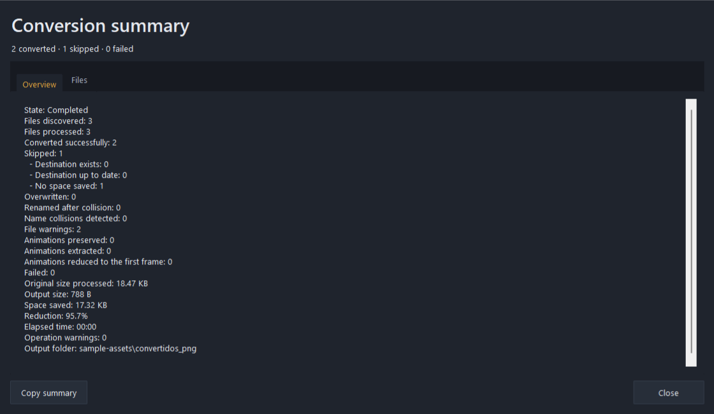
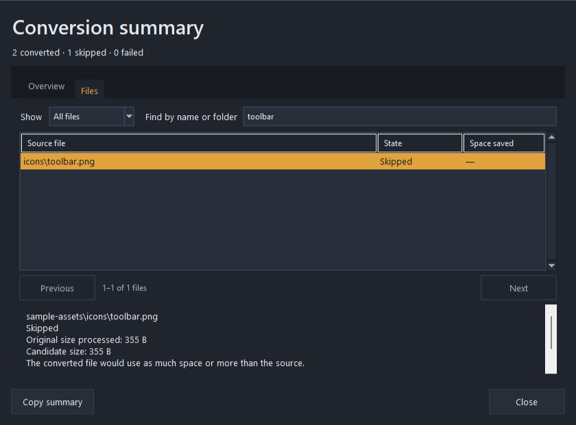
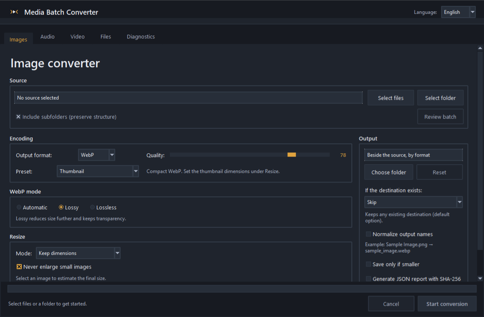
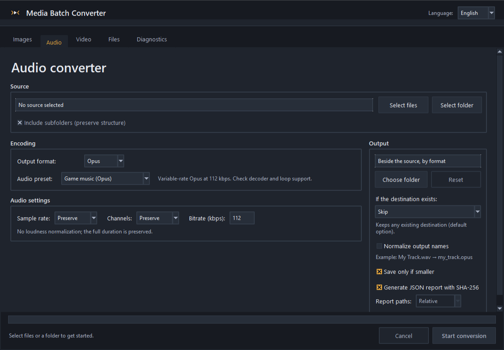
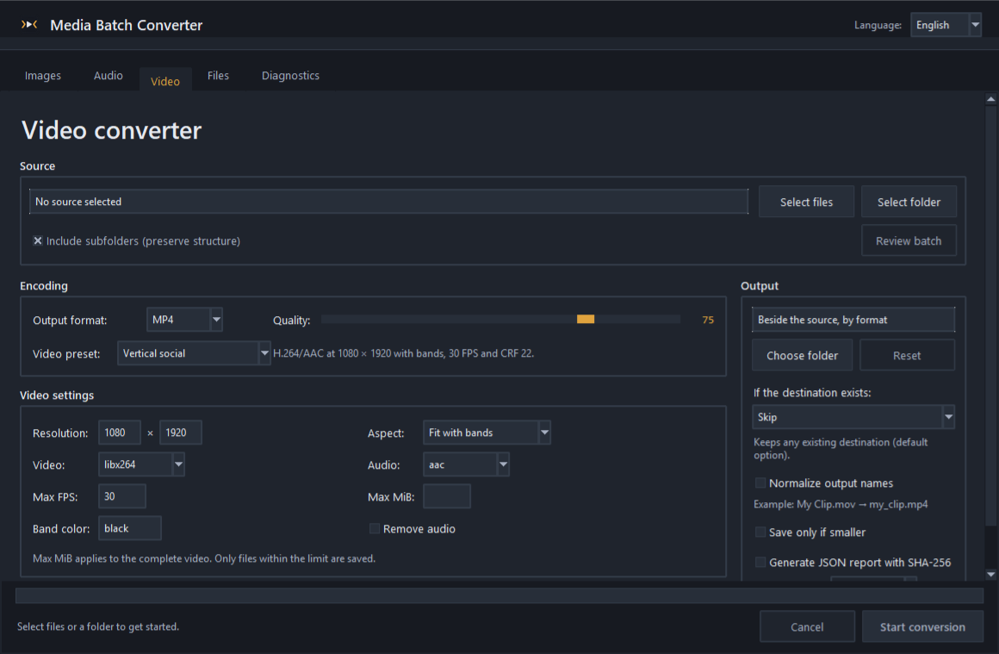
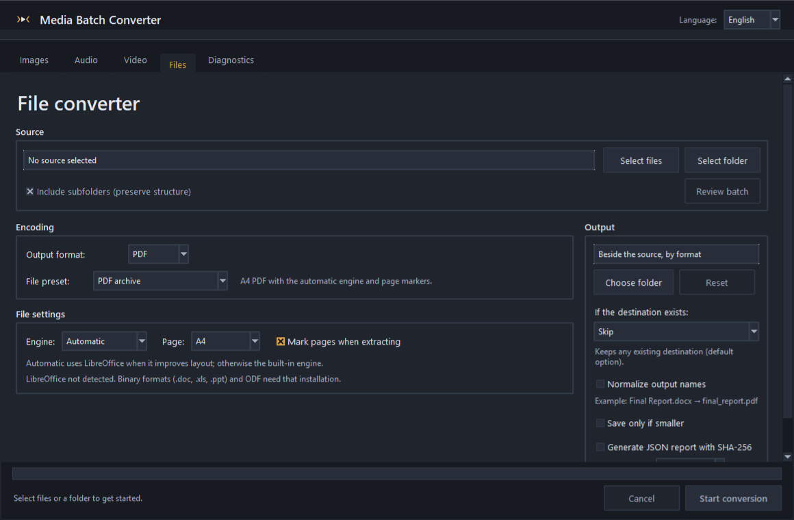

# Media Batch Converter

Convert and optimize images, audio, video, and documents on your desktop. Process a folder of game assets, keep the originals, and review the space saved for each batch.

[Windows download](#download-and-install-on-windows) · [Screenshots](#screenshots) · [Quick start](#quick-usage) · [Compress game assets](#compress-game-assets) · [Supported formats](#supported-formats) · [Run from source](#run-from-source)

## Download and install on Windows

**Media Batch Converter 0.3.0 for Windows x64** · [Download ZIP](https://github.com/JoanOliver04/media-batch-converter/releases/download/v0.3.0/MediaBatchConverter-0.3.0-windows-x64.zip) · [SHA-256](https://github.com/JoanOliver04/media-batch-converter/releases/download/v0.3.0/MediaBatchConverter-0.3.0-windows-x64.zip.sha256) · [Release notes](https://github.com/JoanOliver04/media-batch-converter/releases/tag/v0.3.0)

1. Compare the checksum with the result of `Get-FileHash -Algorithm SHA256 .\MediaBatchConverter-0.3.0-windows-x64.zip` in PowerShell.
2. Extract the complete ZIP and open `MediaBatchConverter.exe`. Keep the `_internal` folder beside it. The portable executable is unsigned, so Windows may show a reputation warning.
3. Images and documents work immediately. For audio and video, download a [Windows FFmpeg build](https://ffmpeg.org/download.html#build-windows). Put its `bin\ffmpeg.exe` in an `ffmpeg` folder beside the app and restart. An installation on `PATH` or an absolute `FFMPEG_PATH` also works. The **Diagnostics** tab shows which executable is active.

To create a desktop shortcut, right-click the executable and choose **Show more options → Send to → Desktop (create shortcut)**.

## Screenshots

### Review the space each batch saved

This sample PNG batch used three synthetic files. Two saved space and one was skipped because the encoded candidate was the same size.





### Image conversion



### Audio conversion



### Video conversion



### File conversion



## Features

- Convert selected files or entire folders, with optional recursive discovery and preserved subfolder structure.
- Choose a separate output parent folder and open the result directly from the batch summary.
- Convert common image, audio, video, and document formats from separate tabs.
- Choose WebP automatic, lossy, or lossless encoding.
- Apply image, audio, video, and file presets, then refine settings manually.
- Resize images proportionally while preserving transparency where the destination supports alpha.
- Create multi-resolution ICO favicons from logos and other images.
- Control video resolution, frame-rate limit, aspect handling, codecs, audio removal, CRF quality, and an optional hard size cap.
- Choose how existing outputs are handled: skip, safe overwrite, unique name, or overwrite only when newer.
- Save converted files only when the measured result is smaller than the source, including companions and extracted frames.
- Keep both files when a batch would otherwise write two sources to the same destination name.
- Optionally normalize generated filenames without renaming originals. Windows reserved device names are always avoided.
- Generate privacy-aware JSON reports with chunked SHA-256 checksums.
- Preserve supported animations, extract frames, or explicitly keep only the first frame.
- Review progress, reopen the latest batch on each tab, filter file results, and retry failed files.
- Switch the interface between Spanish and English at any time from the language selector.
- Read dense settings comfortably in a dark, instrument-style interface built for long sessions.
- Process everything locally. No media is uploaded.

## Supported formats

| Media | Input and output formats |
| --- | --- |
| Images | PNG, JPG, WebP, AVIF, ICO, BMP, TIFF, GIF |
| Audio | MP3, WAV, FLAC, OGG, M4A/AAC, Opus |
| Video | MP4, MKV, WebM, MOV, AVI |
| Files | PDF, DOCX, ODT, RTF, TXT, Markdown, HTML, XLSX, CSV, PPTX; DOC/XLS/PPT/ODP through LibreOffice |

Exact codec availability depends on the Pillow and FFmpeg builds in use. Transparency is retained for compatible image formats; JPEG uses a white background. Animated output is runtime-probed because codec support varies.

## Quick usage

1. Open the Images, Audio, Video, or Files tab.
2. Select one or more files from the same folder, or select a source folder.
3. For folders, choose whether to include subfolders.
4. Select an output format and preset or manual settings.
5. Review the output folder and choose the existing-file policy and optional report settings.
6. Start conversion and review the summary. Use **Last results** to reopen it later.

Outputs are created in a `convertidos_<format>` folder beside the source by default. **Choose folder** uses a different parent and keeps the format-specific subfolder. Existing `converted_*` and `convertidos_*` directories, symbolic links, and Windows directory junctions are excluded from recursive discovery. The app removes empty directories created by unsuccessful conversions.

## Review and retry a batch

- **Overview** shows totals, elapsed time, size changes, the output folder, and any report or discovery warnings.
- **Files** lists converted, skipped and failed files. Use the status filter and page controls to find a file. Select a row to see its paths, size, warnings, and SHA-256 when available.
- **Retry failed files** processes failed entries using the format, encoding settings and destination of the completed batch. It preserves existing outputs by choosing a free filename. Discovery errors remain visible in **Overview** and can be revisited by starting a new folder scan.
- **Last results** keeps the latest completed batch for each tab during the current session. Enable the JSON report before conversion to keep a record on disk.

## Compress game assets

Keep a master copy of the sources. Convert a few representative assets first and check them in the actual game at their display size. Then apply the settings to the full folder. Enable **Save only if smaller** under **Output** to keep conversions that reduce storage. Equal-sized and larger candidates appear as skipped, with the measured candidate size in the summary and JSON report. This also works when converting to the same format.

| Asset | Starting point | What to check in the game |
| --- | --- | --- |
| Sprites, icons and UI | **Lossless archive** (PNG) or **Transparent UI asset** (lossless WebP) | Text edges, transparent borders, and import support |
| Illustrated backgrounds | **Game background (AVIF)** or **General mobile asset** (WebP) | Decoder support, gradients, and detail at the size shown on screen |
| Stereo soundtrack | **Game music (AAC)**, **Game music (Opus)** or **Game music (Vorbis)** where the engine supports them | Compare samples at the same loudness and check loop seams |
| Audio that must remain lossless | **Game audio (FLAC)** for supported PCM inputs | Sample format and playback support |
| Cinematics | **Game cinematic (HEVC)** or the existing **High quality 1080p** H.264 preset | Playback on target devices, frame pacing, and color. The HEVC preset is intended for SDR video |

The indexed PNG candidate must match the source pixels and alpha after any requested resize. The encoder compares actual file sizes for eligible PNG, JPEG, WebP and TIFF candidates. JPEG comparisons keep the chosen quality setting. Automatic WebP preserves low-color images and also tries lossless encoding on eligible still images when it can produce a smaller result. Choosing a compact codec or lowering resolution, bitrate or quality trades storage against fidelity. The video **Max MiB** limit can shorten a clip.

The converter reports loose-file sizes in bytes. A game engine may encode the sources again during import. Check the compressed package in Play Console and the size after app thinning in App Store Connect. [Android game size guide](https://developer.android.com/games/optimize/game-size) · [Apple app size guide](https://developer.apple.com/documentation/xcode/reducing-your-app-s-size)

### Examples

- Convert a transparent PNG to WebP: Images → select file → WebP → Automatic → Start.
- Create a favicon from a logo: Images → select a PNG or another image → ICO (favicon) → Start.
- Convert a recursive image tree: Images → select folder → keep Include subfolders enabled.
- Create an audio master: Audio → select source → WAV master preset.
- Create a compatible MP4: Video → select source → High quality 1080p preset.
- Convert a Word file to PDF: Files → select a DOCX → PDF archive preset → Start.
- Extract text from a PDF: Files → select a PDF → Plain text preset → Start.

## Interface

The conversion workspace groups source selection, encoding and output settings.
The output column moves below the encoding controls in narrow windows. Progress,
Cancel and Start conversion remain visible while you scroll. Use Ctrl+Tab to
switch between tabs, and Tab to reach controls inside the selected workspace.

The palette and typography in `ui/theme.py` apply across the conversion tabs,
summary window and diagnostics console.

## Reproduce screenshots

The images above are generated, not taken by hand:

```powershell
python tools/screenshot.py --all
```

The tool opens the app with the selected tab, language, and preset. It
regenerates the four conversion tab screenshots. The two batch results
screenshots were captured after running the same sample PNG batch.
It captures with `PrintWindow`, which asks the window to draw itself into an
offscreen bitmap: nothing else on the desktop can end up in the picture and the
window does not need to be in front. Settings are redirected to a temporary
folder, so running it never disturbs your own preferences.

Single captures accept a tab, a language and a preset:

```powershell
python tools/screenshot.py --tab video --language es --preset webm_vp9 --output shot.png
```

`--scaling` renders the interface as a high-DPI user sees it, which is useful to
check the layout at 150% or 200%. It enlarges the interface, not the image: the
capture is the window's real pixels, so its resolution is capped by the display.
Native dialogs and open dropdowns are separate windows and do not appear.

## Language

The interface ships in Spanish and English. Pick one from the **Idioma / Language**
selector at the top right of the window; the change applies immediately, without
restarting.

The choice is stored with the rest of the local settings and restored on the next
launch. Spanish is the default. Tabs, controls and summaries follow the active
language. File messages originally recorded in the latest batch and text already
written to JSON reports preserve their original wording. Report warning codes are
stable across languages.

Switching keeps the active tab, selected sources, recursive option, chosen output
parent and latest batch results. Presets and output policies are restored from
preferences. Finish or cancel an active conversion before switching languages.
When closing during a batch, the app waits for cancelled work to clean up.

To add another language, copy `locales/es.py`, translate the values, and register
the module in `i18n.py`. `tests/test_i18n.py` fails if a catalogue is missing a
key or a format placeholder, so gaps surface immediately.

## Image behavior

### Favicons

ICO output preserves transparency and embeds the standard 16, 24, 32, 48, 64, 128, and 256 px square sizes supported by the source dimensions. Square source images are recommended for predictable browser results.

### WebP modes

- Automatic selects lossless for animations, palette images, and sampled images with at most 256 colors; it otherwise uses lossy encoding.
- Lossy uses the quality slider while retaining alpha support.
- Lossless preserves pixel values and uses the encoder's maximum compression effort. The visual quality slider applies to lossy WebP, JPEG and AVIF.

### Resizing

Available modes preserve dimensions, limit width, limit height, fit within a box, or scale by percentage. Resizing uses LANCZOS after EXIF orientation, preserves aspect ratio and transparency, and does not crop or apply AI upscaling. Targets are limited to 16 384 pixels per side.

### Animated images

For animated sources, choose to preserve the animation, extract numbered frames, or keep the first frame. Preservation retains frame order, duration, loop, transparency, and disposal as far as Pillow and the destination codec allow. The destination must support animation. Preservation also limits the total output pixels across frames to bound memory use. Animations with more than 500 frames require First frame only or a split source. A frame export is staged before replacing an earlier one. A folder with unrelated files can be preserved with **Keep both**.

## Document behavior

The Files tab converts through a shared intermediate model, so a new format is one reader or writer rather than a new pair for every existing type. The built-in engine reconstructs text, headings, lists, tables, embedded images and header or footer text from Word `.docx` files, and pictures from PowerPoint `.pptx` files. It does not clone the original page geometry. Password-protected files fail explicitly. Spreadsheet exports neutralize formula-like cells so opening the result does not execute injected formulas.

LibreOffice, when installed, is an optional high-fidelity engine for Office binaries (DOC, XLS, PPT), ODF and layout-sensitive pairs such as DOCX → PDF. It is resolved the same way as FFmpeg: never downloaded, never invoked through a shell, isolated with a temporary user profile, and subject to a timeout. HTML conversions keep companion image files next to the document. The whole LibreOffice process tree is stopped on cancel or timeout. Set `LIBREOFFICE_PATH` to point at `soffice.exe` if the usual install locations are not used.

The automatic engine selects a route supported by Writer, Calc, Impress or the built-in converter. For example, the built-in engine reconstructs slides as HTML and exports spreadsheet tables to PPTX. Forced LibreOffice mode checks the input and output pair before attempting conversion. Native Writer text and Calc CSV exports use UTF-8. [LibreOffice filter documentation](https://help.libreoffice.org/latest/en-US/text/shared/guide/convertfilters.html)

Sources are sniffed by magic bytes. Office packages are checked for zip bombs, member-count limits and unsafe paths. Empty files, symlinks and extension mismatches are rejected before a reader opens them. Oversized embedded images are skipped instead of aborting the whole document.

For eligible PDFs and Office ZIP packages, the app attempts a lossless compression pass and keeps it only when it reduces size. It preserves page content, Office package member bytes and standalone text format requirements. A document's size includes required companion assets when present.

## Presets and output safety

Image presets cover high-quality illustration, general mobile assets, large backgrounds, transparent UI assets, thumbnails, and lossless archives. Audio presets cover playback music, ambience, effects, WAV masters, and voice. Video presets cover 720p, 1080p, vertical social output, horizontal trailers, and VP9 WebM.

Manual edits switch a preset to Custom. Preset state is stored locally.

Existing outputs can be skipped, atomically overwritten, given a deterministic suffix, or replaced only when the source is newer. A failed conversion does not replace an existing destination. Originals are never modified, renamed, or deleted. If several sources in the same batch would share one destination name (`Photo.png` and `Photo.jpg` both becoming `Photo.webp`), both are kept with a `_2` suffix instead of skipping or overwriting one.

Filename normalization is optional. It converts generated basenames to bounded lowercase ASCII identifiers. Windows reserved device names such as `CON` and `NUL` are rewritten even when normalization is off. Collision handling still applies after normalization.

## JSON reports and SHA-256

Optional reports record public settings, final resolved output paths, per-file status, warnings, sizes, and SHA-256 for successful outputs. Hashing is streamed in 1 MiB chunks and supports cancellation. Relative paths are the default; absolute paths require explicit selection. Report writes are atomic, never overwrite an earlier report, and work on NTFS as well as FAT/exFAT and typical cloud-synced folders.

## FFmpeg behavior

FFmpeg is resolved in this order:

1. The trusted executable at the absolute path in `FFMPEG_PATH`, if configured.
2. An `ffmpeg` directory beside the executable, then the internal packaged directory.
3. The executable provided by `imageio-ffmpeg`.
4. An `ffmpeg` command on `PATH`.

Images and documents stay available when FFmpeg is missing. The Diagnostics tab shows the selected FFmpeg provider, LibreOffice if present, and anonymized paths. Audio and video conversion accepts local files through the supported media demuxers. FFmpeg reports progress for both media types, and cancellation cleans up staged outputs. Fitted, cropped and stretched video sizes are made even for `yuv420p`. The optional **Max MiB** may shorten the video. The app checks the output size before publishing the file.

## Run from source

Requirements: Windows, Python 3.12 with Tcl/Tk, and Git.

```powershell
git clone https://github.com/JoanOliver04/media-batch-converter.git
cd media-batch-converter
py -3.12 -m venv .venv
.venv\Scripts\python -m pip install -r requirements.txt
.venv\Scripts\python run_app.py
```

For development tools:

```powershell
.venv\Scripts\python -m pip install -r requirements-dev.txt
```

## Build the Windows executable

```bat
build_windows.bat
```

The script creates an isolated `.build-venv`, installs pinned dependencies, runs the full test suite, generates Windows version metadata from `version.py`, and builds a one-folder distribution with PyInstaller. Expected output:

```text
dist\MediaBatchConverter\MediaBatchConverter.exe
```

Local builds bundle the executable supplied by `imageio-ffmpeg` by default. To select a build explicitly, set `MEDIA_BATCH_BUILD_FFMPEG` to its absolute path. If its folder contains `LICENSE`, the build includes that file. Set `MEDIA_BATCH_BUILD_WITHOUT_FFMPEG=1` to build the public ZIP variant. [Third-party notices](THIRD_PARTY_NOTICES.md)

## Testing and quality checks

```powershell
python -m ruff format --check .
python -m ruff check .
python -m unittest discover -s tests -q
```

Run the format matrix on its own with `python -m unittest discover -s tests -p test_format_matrix.py -v`. It generates temporary fixtures for the supported extensions and decodes the resulting files again. Audio and video tests use the configured FFmpeg binary. To test all native document pairs as well, install LibreOffice and set `MEDIA_BATCH_TEST_LIBREOFFICE_MATRIX=1` before running the command.

Tests cover pure calculations, error and collision policies, recursive batches, reports, image transparency and animation, Unicode audio paths, video without audio, packaged resource resolution, accessibility scaling, catalogue consistency and language switching, document security checks, and integration combinations.

## Project structure

```text
run_app.py                    Safe launcher and dependency checks
tools/screenshot.py           Reproducible application screenshots
i18n.py                       Active language and message lookup
locales/                      One message catalogue per language (es, en)
ui/                           Tkinter presentation layer
  app.py                      Main window, tabs, and entry point
  base.py                     Shared controls, batch flow, and reporting
  ffmpeg_panel.py             Shared FFmpeg process and batch handling
  image_panel.py              Image tab and image batch conversion
  audio_panel.py              Audio tab
  video_panel.py              Video tab
  formats.py                  Supported formats and output path resolution
  theme.py                    Palette, typography and ttk styling
  widgets.py                  Scrollable tab viewport
  summary_dialog.py           Batch totals, per-file details and retry action
  diagnostics.py              Diagnostics tab
  document_panel.py           Files tab
documents/                    Document conversion package
  conversion.py               Engine choice and one-file orchestration
  formats.py                  Conversion matrix
  security.py                 Type sniffing and zip-bomb limits
  textio.py / pdfio.py / office.py  Built-in readers and writers
  libreoffice.py              Optional high-fidelity engine
batch_processing.py          Recursive discovery
process_control.py           Encoding-safe subprocess helpers and shutdown
conversion_results.py        Shared result and summary models
conversion_report.py         JSON reports and streamed checksums
image_*.py / webp_encoding.py Image services and validation
audio_encoding.py            Audio settings and FFmpeg arguments
video_encoding.py            Video settings, arguments, and progress
runtime_environment.py       Dependency and packaged-resource resolution
version.py                   Public name and version source
tests/                       Automated test suite
```

Audio and video share `FFmpegPanel` rather than one inheriting from the other. Code identifiers and documentation are English; user-facing text lives in `locales/`, never inline in the modules, and every color and font comes from `ui/theme.py`.

## Troubleshooting

- Pillow missing: activate the intended environment and run `python -m pip install -r requirements.txt`.
- Audio or video disabled: install project dependencies or place a working FFmpeg on `PATH`, then restart.
- Codec unavailable: inspect the Diagnostics tab and choose a format supported by that FFmpeg build.
- Tkinter unavailable: reinstall official Python for Windows with Tcl/Tk enabled.
- Permission or disk-space error: choose a writable source location with enough free space.
- Detailed failures: inspect the rotating local log path shown in Diagnostics. Normal dialogs omit stack traces.

## Privacy

All processing is local. Files are not uploaded, and the application has no network conversion service. Originals are not modified or deleted. JSON reports use relative paths by default, and copied diagnostics anonymize the user-home directory.

## Limitations

- Only Spanish and English are available; other languages need a new catalogue.
- Windows is the tested packaged target; source execution elsewhere is not guaranteed.
- Release binaries are not code-signed.
- FFmpeg codec support and patent considerations vary by build and jurisdiction.
- Metadata and ICC preservation depend on the selected format and are intentionally limited for some image outputs.
- CRF targets visual quality. The optional Max MiB field can shorten the video or reject a result that exceeds the selected size.
- Animations longer than 500 frames cannot be preserved or extracted in a single conversion.
- No installer or automatic updater is provided.

## Contributing and security

Read [CONTRIBUTING.md](CONTRIBUTING.md) before proposing a change. Use the issue templates for reproducible bugs and focused feature requests. Report vulnerabilities through the process in [SECURITY.md](SECURITY.md), not a public issue.

## Release process

The complete release checklist is in [RELEASING.md](RELEASING.md). Releases follow Semantic Versioning. See [GitHub Releases](https://github.com/JoanOliver04/media-batch-converter/releases) for downloads and [CHANGELOG.md](CHANGELOG.md) for the version history.

Suggested repository topics: `python`, `tkinter`, `pillow`, `ffmpeg`, `image-converter`, `audio-converter`, `video-converter`, `batch-processing`, `webp`, `desktop-app`, `media-tools`.

## Roadmap

Potential future work includes localization, signed builds, an installer, configurable output roots, more packaged-platform testing, and optional hardware-encoding profiles. Roadmap items are not commitments.

## License

Project source code is available under the [MIT License](LICENSE). Dependencies and bundled FFmpeg remain under their own licenses; consult [THIRD_PARTY_NOTICES.md](THIRD_PARTY_NOTICES.md). No legal guarantee is provided.
